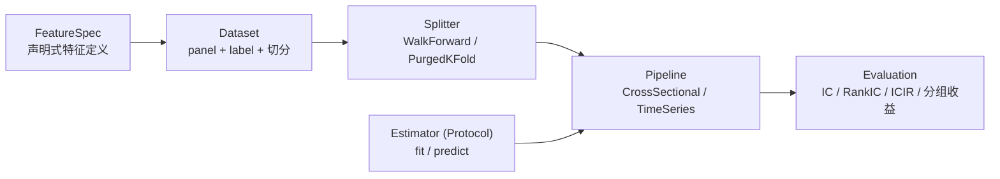

# 建模扩展性：线性模型到机器学习

## 现状与问题

旧仓的建模方法几乎全是线性与凸优化：

| 方法 | 位置 |
|---|---|
| WLS 中性化与正交 | `alpha_factory/factor_math.py`、`alpha_factory/preprocessing.py` |
| 截面 OLS | `alpha_factory/research/exposure.py`、`multi_asset/views.py`、`factors/factor_etf.py` |
| scipy 风险平价 | `enhanced_optimizer/risk_parity.py`、`multi_asset/risk_budget.py` |
| 层次聚类 | `agent_style_rotation/price_cluster.py` |

`sklearn` 与 `lightgbm` 只出现在一个文件（`strategy/prediction_of_sse.py`），
且无任何包外引用，是实验脚本。

真正的障碍不是"没用过 ML"，而是**没有统一的数据集与评价抽象**。各研究线
自建 panel、自定义 IC 计算、自己处理切分。这种情况下引入 ML 只会再多一套
自建流程，不会带来可比性。

所以扩展性的关键不在"支持哪些算法"，而在**把模型从策略代码里剥离成可替换
的实现，并让数据集、切分、评价保持统一**。

## 抽象链条



### FeatureSpec

声明式的特征定义，属于 `features/spec/`。包含输入依赖、参数、计算延迟、
频率、可见性规则引用。它是 `Dataset` 的输入清单，也是 `matrix_id` 的组成
部分。

### Dataset

`panel + label + 时间切分`。职责：

- 从因子长表按 `feature_set` 与 `universe_id` 取数，物化为宽矩阵（经
  `models/matrix/`，带 `matrix_id` 版本绑定）
- 构造标签（前瞻收益），**标签的前瞻窗口必须显式声明**
- 对齐特征与标签的时间关系，保证特征的 `knowledge_dt` 不晚于决策时点

`Dataset` 是防泄漏的第一道关口：特征与标签的时间关系在这里固定，下游无法
绕过。

### Splitter

`WalkForward`（滚动训练）与 `PurgedKFold`（带 purge/embargo 的交叉验证）。

标签窗口与特征窗口重叠时必须 purge——例如用 20 日前瞻收益做标签，训练集
末端与验证集开头之间必须留出至少 20 日间隔，否则验证集的信息已经泄漏进
训练标签。

`embargo` 处理的是另一回事：截面相关性。同一天的不同资产不是独立样本，
按时间切分时相邻区间要留缓冲。

这两件事写进切分器并有测试覆盖，比写在文档里靠人记得可靠。

### Estimator

Protocol，两个方法：

```python
class Estimator(Protocol):
    def fit(self, X, y, sample_weight=None) -> Self: ...
    def predict(self, X) -> np.ndarray: ...
```

刻意兼容 sklearn API，这样 sklearn 生态的工具（管道、网格搜索、校准）可以
直接用，也不需要为每个新算法写适配层。

| 实现位置 | 内容 |
|---|---|
| `estimators/linear/` | WLS 中性化、截面 OLS、岭回归 |
| `estimators/ml/` | LightGBM、（后续）神经网络 |

**接 LightGBM 只需新增 `estimators/ml/`，`Dataset`、`Splitter`、
`Pipeline`、`Evaluation` 全部不动。** 这是扩展性的具体含义。

依赖分组上也做了显式切换：`pyproject.toml` 里 `ml` 是 optional extra，
不装它就跑不了 ML estimator。这让「当前只有线性模型」在依赖层面可见，也
避免把重依赖强加给只跑线性模型的场景。

### Pipeline

`CrossSectionalPipeline`（逐截面拟合，如每日截面 OLS）与
`TimeSeriesPipeline`（时序滚动拟合）。职责是编排 Dataset、Splitter、
Estimator 的调用顺序，处理预处理（去极值、标准化、中性化）的拟合-应用分离。

**预处理参数只能在训练集上拟合**。去极值阈值、标准化的均值方差、中性化的
回归系数都是要拟合的量，用全样本拟合等于泄漏。这一点在 Pipeline 层强制。

### Evaluation

IC、RankIC、ICIR、分组收益、衰减曲线、换手率。

口径统一在这一层是必要的：IC 的计算细节（剔空值还是填充、pearson 还是
spearman、分母用哪个域）如果各研究线自定义，不同研究线的 IC 就无法横向
比较。旧仓的「分母口径固定」铁律说的就是这件事。

分组收益的实现落在 `strategy/backtest/vectorized/`——它是无账户的向量化
计算，不属于建模层，但由 `Evaluation` 调用。

## 模型产物

落 `var/artifacts/models/<model_id>/`：

```
<model_id>/
├── manifest.json     训练配置 digest、matrix_id、代码版本、run_id、数据截止日
├── model.<ext>       框架原生格式（不用 pickle）
├── importance.json   特征重要性或系数
└── metrics.json      训练集与验证集指标
```

`model_id = digest(feature_set_id, universe_id, splitter_config,
estimator_config, matrix_id)`。身份变了就是新模型，不复用旧结论。

**不用 pickle 存长期产物**。pickle 跨 Python 与库版本不稳定，且不可读。
旧仓有 `signal_cache_*.pkl` 与 `day_result.pkl` 这类无身份的 pickle，三个
月后无法判断是哪次训练的产物。

## 预测值落 model 层

模型的输出是预测值，进 `var/lake/model/`，与因子长表结构类似但语义不同——
它是模型产物，不是原始特征。这也是数据面需要 `model` 层的原因：只有这样
才能区分「这个信号是模型产出的」和「这个信号是规则产出的」。

从预测到仓位是 `strategy` 的职责，不在建模层。

## PIT 在建模链条上的传递

- 特征的 `knowledge_dt` 与 `pit_grade` 来自因子长表
- `Dataset` 按 `as_of` 取数，保证只用当时可见的特征
- 模型的 `pit_grade` 沿输入取最差值继承
- 预测值写入 `model` 层时同样带 `knowledge_dt` 与 `pit_grade`

木桶原理一路传到发布层的 `pit_report`，见
[../domain/pit-rules.md](../domain/pit-rules.md)。

## 不做的事

- **不建 AutoML 框架**。没有真实需求前不预建超参搜索服务、模型注册中心、
  实验追踪平台。
- **不预建深度学习基础设施**。`estimators/ml/` 的扩展点已经留好，真正需要
  时加依赖加实现，不提前搭 GPU 训练流水线。
- **不为兼容 ML 而牺牲线性模型的清晰度**。WLS 中性化的实现应该读起来就是
  WLS，不应该为了套进某个通用框架而变得绕。
