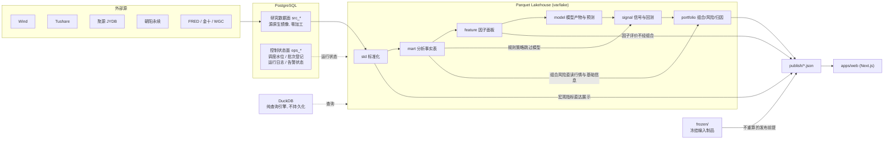

# 架构总览

## 这是什么

个人维护的量化投研系统。数据从外部源进入 PostgreSQL 源镜像层，经 Parquet
Lakehouse 完成标准化、口径对齐、因子计算、建模、信号与组合，最终装配为发布
产物供展示层消费。DuckDB 作查询引擎，Dagster 作资产化编排。

它重构自 `pycharm_workspace`。重构的动因不是「代码写得不好」，而是四类结构
性问题已经开始产生真实的维护成本：数据分层与程序分层都不清晰、时间语义
（PIT）靠读取时过滤而非规则声明、脚本与文档失去归属、工程基建缺位。

## 六条设计原则

### 1. 分层是职责划分，不是强制管线

数据层定义「我负责什么、我可以依赖谁」，研究线按需取用。宏观指标展示不必
穿过因子层，因子评价不必穿过组合层，规则策略不必穿过模型层。

只有两条硬约束：**不得反向依赖、不得同层成环**。跨层直读允许，但必须在资产
契约里声明 `reads:`，让血缘图可见。

### 2. 口径规则与存储实现彻底分离

`domain/` 是纯规则层，零存储依赖，能在没有数据库和文件的条件下完整单测。
读取接口以 Protocol 形式定义在 `domain/ports/`，`adapters/` 提供
PostgreSQL、Parquet+DuckDB、内存三套实现。

这条原则的代价是多一层间接，收益是：换存储、迁数据库、调分区布局都只动
适配器。旧仓的 `BaseDataGateway` 自身 `from dbconnect import DBConnect`，把
规则和传输绑死，导致「换库」等于「重写所有网关」。

### 3. 时间语义必须显式声明，不能推测

业务时间、来源发布时间、系统采集时间是三条独立的轴，**三者都不是 PIT**。
可见日 `knowledge_dt` 是由声明式规则计算出的派生结果。规则缺失是唯一
fail-closed 的情形。

因子的 `knowledge_dt` 与 `pit_grade` 由血缘自动推导，不接受人工填写；
`pit_grade` 沿依赖图取最差值继承，不可手工抬升。

详见 [../domain/temporal-semantics.md](../domain/temporal-semantics.md) 与
[../domain/pit-rules.md](../domain/pit-rules.md)。

### 4. 契约是代码，不是文档

数据集 schema、发布产物 schema、可见性规则都是可执行的，在 CI 中运行。旧仓
`docs/data_dictionary/` 的 318 张表字典是文档，无法阻止实现漂移。

### 5. 入口只有两处

`quantagent <group> <command>` 和 Dagster asset/job。**没有 `scripts/`
目录**，pre-commit 与 CI 都会拦。探索性代码进 `notebooks/` 并有过期规则。

旧仓 `scripts/` 有 316 个脚本，只有约 8% 是长期入口，约 81% 既不在调度也不
在现役文档中——这不是纪律问题，是缺少「该往哪放」的答案。

### 6. 机械检查只覆盖可机械检查的部分

`import-linter` 防反向引用与循环，`ruff` 管风格，`mypy` 管类型，契约测试管
行为口径，frontmatter 校验管文档生命周期。但**职责定义靠文档**——
`architecture/layers/` 下每层一份，写清负责什么、不负责什么、典型反例。

工具能证明「没有反向 import」，不能证明「这段逻辑放对了层」。

## 数据流：分支依赖图



主干只是常见路径，图中的旁路同样是一等形态。数据层职责与允许依赖的完整
定义见 [data-layers.md](data-layers.md)。

## 程序分层

```
orchestration / cli          composition root，允许依赖全部层
        ↓
publish → agents → portfolio → strategy → models → features
        ↓
     lake / ingest → adapters（实现 domain.ports）
        ↓
     domain（含 ports，纯规则，零存储依赖）
        ↓
     contracts → platform
```

箭头是「可以依赖」的方向。`platform` 是唯一允许接触连接串的层；
`ingest` 是唯一允许写 PG 研究数据面的层。

依赖方向由 `pyproject.toml` 的 import-linter 契约强制，包括四条禁止规则：
domain 不得触碰存储实现、contracts 不得做 IO、业务层不得直接用 PG 驱动、
业务层不得依赖 composition root。

## 存储选型

| 用途 | 选型 | 理由 |
|---|---|---|
| 源数据原生镜像 | PostgreSQL `src_*` | 需要事务、约束和跨表查询；psycopg3 不依赖 ODBC/JDBC，macOS 与 Windows 行为一致 |
| 控制状态 | PostgreSQL `ops_*` | Dagster 运行存储原生支持；与研究数据同实例不同 schema，规则完全隔离 |
| 派生事实（std/mart/feature/model/signal/portfolio） | Parquet | 列存、分区裁剪、可版本化、可迁移；不锁定在单一数据库 |
| 查询引擎 | DuckDB | 零运维、原生读 Parquet、单机性能足够；不持久化 `.duckdb`，每次会话从 Parquet 挂载 |
| 冻结输入制品 | `frozen/`（git） | 发布前提，不可重算，必须随代码一起分发 |
| 发布产物 | `publish/`（git） | 小体积 JSON，展示层唯一数据来源 |

选型理由与被否方案见 [../adr/2026-09-16-storage-selection.md](../adr/2026-09-16-storage-selection.md)。

## 运行环境

Python 3.12，`uv` 管理依赖与虚拟环境，依赖锁在 `uv.lock`。两套部署档位
（`local` 本机开发镜像库、`office` 公司主库）只在连接参数和 lake 根路径上
不同，代码路径完全一致。

旧仓被公司 Windows 的 SQL Server 驱动锁在 Python 3.8，同时开发机跑 3.9，
长期两套语义。迁到 PostgreSQL + psycopg3 后这个约束自然消失，因此统一到
3.12，并用 `ruff` 的 `UP` 规则强制使用 3.12 惯用写法。

## 当前状态

P1 第一刀：`platform` 配置/路径/digest/run log/写闸、契约 YAML 加载、缺
visibility 时 CI fail-closed、第一个数据集 `std.trade_calendar`。尚未建 PG
schema，尚未采集。后续阶段与验收标准见
[../migration/roadmap.md](../migration/roadmap.md)。
