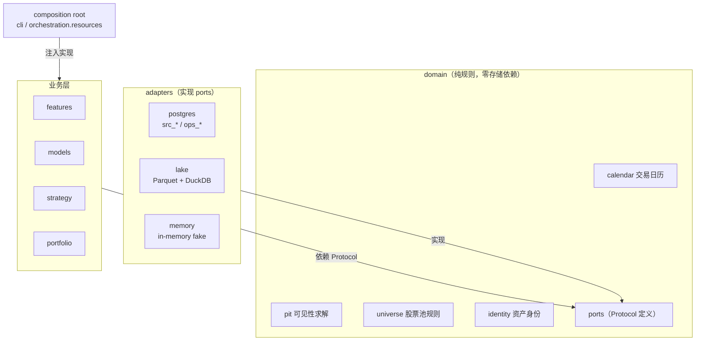

# 端口与适配器

## 要解决的问题

旧仓 `core/data_gateway_base.py` 的 `BaseDataGateway` 是一个有价值的抽象——
它统一了读边界、死锁重试、IN 分块和 PIT 原语 `latest_visible_by_key`。但它
自身 `from dbconnect import DBConnect`，于是：

1. PIT 规则无法脱离数据库测试。要验证「报告期跨年 + 公告日晚于季末」这种
   边界，得先准备一个 SQL Server。
2. 换存储等于重写所有网关。`alpha_factory/etf/gateway.py`、
   `macro_regime/pit.py`、`enhanced_optimizer/data/gateway.py` 都继承它。
3. 绕过它的成本比用它低。结果是 139 个文件直接 `import dbconnect`，读边界
   形同虚设。

第三条最关键：**一个抽象如果比绕过它更麻烦，它就会被绕过。** 因此新设计的
目标不只是"分层正确"，还包括"用起来比绕过更省事"。

## 结构

业务层拿到的永远是 Protocol，不知道背后是 PostgreSQL 还是 Parquet。

## 端口设计规则

### 只出现领域概念

接口签名里允许出现：`as_of`、`asset_id`、`universe_id`、`event_dt`、
`freq`、`feature_key`、`period_end`。

**不允许出现**：表名、schema 名、SQL 片段、`where` 子句、文件路径、分区
表达式、连接对象。

判断标准很简单：**把底层从 PostgreSQL 换成 Parquet，接口签名不应有任何
变化。** 如果需要改签名，说明抽象漏了。

### as_of 是必填的

所有涉及时间的读取接口，`as_of` 都是必填参数，没有默认值，没有"不传就是
最新"的便捷路径。

这是刻意的不便。只要存在一条不传 `as_of` 的路径，它就一定会被用在需要 PIT
的地方，而这种错误是静默的——结果看起来完全正常，只是包含了未来信息。

### 返回形状由契约固定

返回的 DataFrame 形状由 `contracts/schemas/` 描述并在适配器出口校验。这样
三套实现不会在列名、类型、空值语义上悄悄分叉。

### 端口清单（P3 落地）

| Protocol | 职责 |
|---|---|
| `CalendarRepository` | 交易日历原始数据。日历**规则**在 `domain/calendar` |
| `AssetIdentityRepository` | 资产基础信息、代码映射、生命周期 |
| `UniverseRepository` | 股票池成分与生效区间 |
| `PriceRepository` | 行情与复权因子 |
| `FundamentalRepository` | 财务与一致预期，按 `period_end` 与版本 |
| `MacroRepository` | 宏观序列 |
| `FeatureRepository` | 因子长表读写 |
| `SignalRepository` | 信号与回测结果 |
| `PortfolioRepository` | 组合权重与持仓 |

注意 `CalendarRepository` 与 `domain/calendar` 的分工：仓储只负责"把交易日
列表取回来"，"T+3 是哪天"、"这个区间有几个交易日"是规则，在 `domain`。这个
分工让日历规则的测试可以用一个硬编码的日期列表，不需要任何存储。

## 三套适配器

| 适配器 | 后端 | 用途 |
|---|---|---|
| `postgres` | psycopg3 + PG | 源数据读取、控制状态读写 |
| `lake` | DuckDB + Parquet | 派生事实的读写 |
| `memory` | 纯内存 | 测试，让业务层单测完全脱离外部依赖 |

适配器承担的传输细节：连接获取与归还、IN 子句分块、死锁与超时重试、参数化
查询构造、谓词下推、分区裁剪、列投影、批量分页游标。

`memory` 不是 mock。mock 不参与契约测试，等于没有一致性保证；`memory` 必须
是真实的 in-memory 实现，跑同一套契约断言。

### 适配器执行口径，不决定口径

适配器收到的是已被 `domain` 解析好的参数。例如 PIT 过滤：`domain/pit` 根据
声明式规则算出「可见性条件」，适配器把它翻译成 `WHERE` 或 Parquet 谓词，
但不自行判断某个数据集该用哪条规则。

反面情形：适配器自己决定"行情缺失就取前一交易日"。这是口径决策，会让同一
份规则在不同适配器下产生不同结果。

## 契约测试

`tests/contracts/` 对三套适配器跑同一套断言。这是「换存储不改业务」这个
承诺的唯一证据。

必须覆盖的一致性维度：

- 空结果的返回形状（空 DataFrame 而非 `None`，且列齐全、类型正确）
- 缺列、缺分区时的错误类型
- 重复键的处理
- 时区与日期类型
- `as_of` 边界（等于、早于、晚于可见日各一例）
- 大 IN 列表的分块正确性（分块后结果与不分块一致）

## 从旧仓继承口径

保留的是**口径与测试**，替换的是底层实现。

| 旧仓资产 | 拆分去向 |
|---|---|
| [`core/data_gateway_base.py`](/Users/le/PycharmProjects/pycharm_workspace/core/data_gateway_base.py) 的读边界语义与 `latest_visible_by_key` | `domain/ports` 接口契约 + `domain/pit` 规则实现；死锁重试与 IN 分块下沉到 `adapters` |
| [`core/universe_provider.py`](/Users/le/PycharmProjects/pycharm_workspace/core/universe_provider.py) 的 `UniverseProvider` | `domain/universe` 规则 + `UniverseRepository` 端口 |
| [`core/market_data_service.py`](/Users/le/PycharmProjects/pycharm_workspace/core/market_data_service.py)（2804 行） | 按数据类型拆到 `PriceRepository`、`AssetIdentityRepository`、`CalendarRepository`；口径抽成契约测试 |
| `alpha_factory/etf/gateway.py`、`macro_regime/pit.py`、`enhanced_optimizer/data/gateway.py` | 口径逐条抽取为契约测试，不保留独立网关 |

### golden test 对拍：迁移的唯一验收手段

固定手法，四步：

1. **取快照**：用旧库真实数据生成 fixture，落 `tests/fixtures/`。快照要
   覆盖边界情形（停牌、退市、代码复用、报告期跨年、非交易日端点），不是
   随便取一段。
2. **固化旧行为**：把旧网关在该快照上的**现有输出**写成期望值。此时不判断
   对错，只记录事实。
3. **新实现对拍**：新实现跑同一套 fixture，输出必须逐值一致。
4. **差异必须有解释**：任何差异都要判定是「新实现有 bug」还是「旧实现有
   bug」。前者修新实现；后者修正期望值、在 `docs/adr/` 记一页说明原因，
   然后更新基线。**不允许静默改基线。**

这套手法的目的是防止「重构顺手改了口径」。口径漂移是重构中最危险的错误，
因为它不报错、不崩溃，只是让所有历史结论悄悄失效。

golden 测试不证明旧实现正确，只证明新旧一致或差异已知。

## 何时可以新增端口

新增读取需求时，优先窄扩展现有 Protocol（加一个字段、加一个过滤参数），
而不是新建 Protocol。新建的门槛是：这组数据有独立的时间语义或独立的身份
体系。

严禁的做法是「某个研究线自己建一个网关」。旧仓正是这样长出了四五套并行
网关，口径差异无人知晓。
